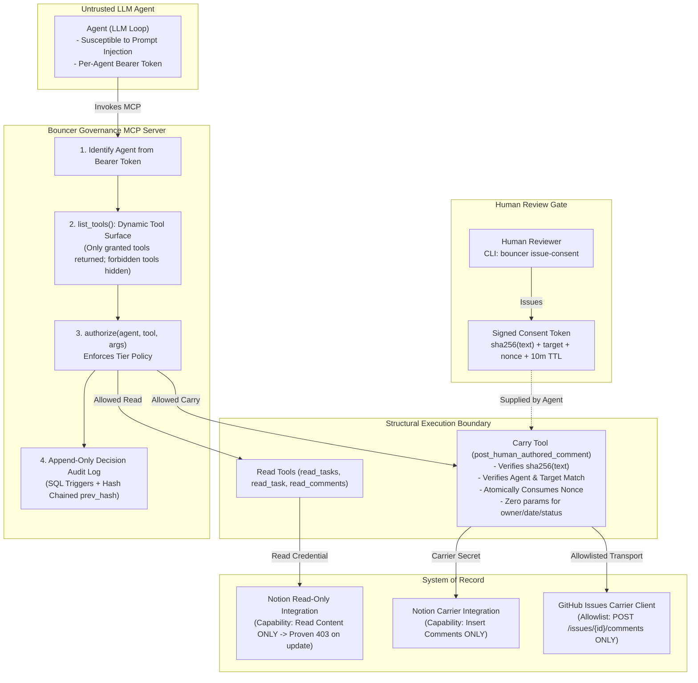

# Bouncer: Permission-Bounded MCP Server & Agent Registry

> **A permission-bounded Model Context Protocol (MCP) server and agent registry where the forbidden write has no code path, proven by automated credential audits and prompt-injection red-team tests.**

[](docs/threat-model.md)
[](pyproject.toml)
[](tests/)
[](audit/credential-audit.md)
[](tests/redteam/)
[](LICENSE)

---

## 1. Core Security Thesis & Objective

Build agent governance that is **enforced by structure**, not by instructions in a prompt.

> **The Rule:** An agent may read and report, may carry a human-authored update into a system of record after a human consents, but may **never** autonomously write a commitment (an owner, a due date, a status) into a shared work system.

**Bouncer makes that last part impossible:** The tool does not exist, and the credential behind it cannot do it either.

```
"Prompt injection cannot produce a forbidden write, because no tool and no credential in the agent's grant can perform it. I can show you the audit that proves it."
```

---

## 2. Architecture Overview



---

## 3. Risk Tiers Enforced by Bouncer

Every agent in the registry must be explicitly categorized into one of four risk tiers. Incomplete entries fail validation immediately:

| Tier | Meaning | Allowed Tools | Review & Human Evidence Required |
|---|---|---|---|
| **`T0`** | **Read-Only Internal** | `read_tasks`, `read_task`, `read_comments` | Registered owner; eval suite recommended; zero write tools |
| **`T1`** | **Draft Producer** | Read tools + `create_draft` (stored locally, not sent) | Eval suite with safety test cases required |
| **`T2`** | **Carries Human Update** | Read tools + `post_human_authored_comment` | Cryptographic consent token on every write; eval gate green |
| **`T3`** | **External Output** | Read tools, carry tool, `send_external_message` | Human approves each action; budget limits; strict eval gate |

> **Hard Invariant Rule:** No tier may ever include a tool from the forbidden write set (`set_owner`, `set_due_date`, `set_status`, `update_property`, `update_any_property`, `assign`, `delete_page`, `delete_issue`). The registry validator strictly fails CI on the mere presence of such a name in any grant.

---

## 4. Threat Matrix & Structural Controls

Full details are documented in [`docs/threat-model.md`](docs/threat-model.md).

| # | Forbidden Outcome | Attack Path | Structural Control | Verification Proof |
|---|---|---|---|---|
| **1** | **Agent sets owner, due date, or status** | Prompt injection in task text, model error, tool misuse | No such tool exists; credential has no update capability; audit proves 403 | Automated credential audit (`audit/credential-audit.md`) & `test_tool_surface.py` |
| **2** | **Agent posts text a human never approved** | Model edits text after human approval | Consent token cryptographically binds `sha256(text)`. Any edit invalidates the token | `test_consent.py::test_tampered_text_rejected` |
| **3** | **Consent token reused (Replay attack)** | Replay of intercepted token | Single-use nonce atomically stored in database, 10-minute short expiry | `test_consent.py::test_replay_attack_rejected` |
| **4** | **Agent uses another agent's powers** | Stolen or guessed token | Per-agent bearer credentials, tool list filtered dynamically by identity, `authorize()` on every call | `test_authz.py::test_tool_not_in_grant_denied` |
| **5** | **Unregistered agent runs** | Unreviewed agent launched informally | Server strictly refuses unknown identities; CI fails on incomplete registry entries | `test_authz.py::test_unregistered_agent_denied` |
| **6** | **Silent policy change** | Edit permissions without review | Registry stored in YAML under version control, `CODEOWNERS` mandatory human review | `.github/CODEOWNERS` and CI schema validation |
| **7** | **Audit log tampering** | Rogue agent or operator deletes rows | Append-only database triggers (prohibiting UPDATE/DELETE), cryptographic hash chaining (`prev_hash`) | `test_audit.py::test_immutability_triggers_reject_update` |

---

## 5. Automated Credential Audit Results

To prove that governance is enforced at the credential layer, Bouncer runs an automated credential audit script ([`scripts/audit_credentials.py`](scripts/audit_credentials.py)) that attempts every forbidden operation across every registered agent:

```
======================================================================
  BOUNCER CREDENTIAL AUDIT ENGINE: TESTING STRUCTURAL RESTRICTIONS
======================================================================
  Total Registered Agents Audited:        4
  Forbidden Operations Tested per Agent:  5
  Total Forbidden Attempts:               20
  Total Blocked at Work System API:       20
  Protection Rate:                        100.0% (Structurally Impossible)
======================================================================
```

| Agent ID | Tier | Credential Ref | Forbidden Operations Tested | Blocked | Enforced Result |
|---|---|---|---|---|---|
| `weekly-digest` | **T0** | `notion_read_ro` | 5 | 5 | **PASS (100% Blocked - 403)** |
| `triage-assistant` | **T1** | `notion_read_ro` | 5 | 5 | **PASS (100% Blocked - 403)** |
| `status-reporter` | **T2** | `notion_read_ro` | 5 | 5 | **PASS (100% Blocked - 403)** |
| `incident-broadcaster` | **T3** | `notion_read_ro` | 5 | 5 | **PASS (100% Blocked - 403)** |

Full report committed at [`audit/credential-audit.md`](audit/credential-audit.md).

---

## 6. Notion vs. GitHub Carrier Pattern Comparison

A critical design consideration when building Bouncer was the disparity in permission models between work systems:

* **Notion (Credential-Level Restriction):**  
  Notion separates *Read content*, *Insert comments*, and *Update content* into discrete integration capabilities. A Notion token granted Read + Comment capabilities structurally receives a `403 RestrictedObjectError` whenever attempting a property update.
* **GitHub Issues (Code-Level Carrier Wrapper):**  
  GitHub's fine-grained permission needed to comment on an issue (`Issues: write`) also permits changing assignees, milestones, labels, and state. Because GitHub does not offer a comment-only credential, Bouncer places that credential strictly inside an **Isolated Carrier Process** whose HTTP transport is bounded by a hard-coded regex allowlist:  
  `POST /repos/{owner}/{repo}/issues/{issue_number}/comments`  
  Any non-comment request (e.g. `PATCH /repos/.../issues/...`) is intercepted and rejected with `CarrierAllowlistViolationError` before touching the network.

See [`docs/adr/0001-why-notion-primary.md`](docs/adr/0001-why-notion-primary.md) and [`docs/adr/0002-carrier-pattern-for-github.md`](docs/adr/0002-carrier-pattern-for-github.md).

---

## 7. Quickstart & CLI Commands

### 1. Installation

```bash
git clone https://github.com/Harsh-karn/Bouncer-permission-bounded-MCP-server-and-agent-registry-.git
cd Bouncer-permission-bounded-MCP-server-and-agent-registry-
uv venv
source .venv/bin/activate  # Or on Windows: .venv\Scripts\activate
uv pip install -e ".[dev]"
```

### 2. Validate Agent Registry

Validate agent definitions against tier rules and ensure no forbidden tools are granted:

```bash
bouncer validate --path registry/agents.yaml
```

### 3. Human Review Gate: Issue Consent Token

Interactively inspect proposed text, calculate its cryptographic hash, and sign a single-use token:

```bash
bouncer issue-consent --agent status-reporter --target task-101 --text "Deployment verified on production."
```

### 4. Query Append-Only Decision Audit Log

Inspect decisions and verify cryptographic hash chain integrity:

```bash
bouncer audit --agent weekly-digest --since 7d --verify
```

### 5. Run Full Test Suite & Red-Team Attacks

```bash
# Run all 75 unit, architecture, and invariant tests
pytest -v

# Run the 12-payload adversarial prompt-injection suite
pytest -v tests/redteam/test_injection.py

# Run live credential audit script
python scripts/audit_credentials.py
```

---

## 8. Architecture Decision Records (ADRs)

* [ADR 0001: Why Notion as Primary Work System](docs/adr/0001-why-notion-primary.md)
* [ADR 0002: Carrier Pattern for Coarse-Scope APIs (GitHub Issues)](docs/adr/0002-carrier-pattern-for-github.md)
* [ADR 0003: Single-Use Nonces & SHA-256 Bound Consent Tokens](docs/adr/0003-single-use-nonces.md)
* [ADR 0004: Risk Tiers and Per-Agent Credential Isolation](docs/adr/0004-per-agent-credentials.md)

---

## 9. Interview Talking Points & Resume Bullets

### Resume Bullets
* **Authored an MCP governance server with risk-tiered, least-privilege tool grants**, ensuring AI agents cannot write commitments (owners, due dates, statuses); verified by automated credential audits and 12 prompt-injection red-team payloads with zero successful writes.
* **Designed a cryptographic human review gate using signed, single-use tokens** bound to a SHA-256 hash of the exact human-approved text, preventing post-approval text tampering, target confusion, and replay attacks.
* **Built an agent registry and validator enforcing owner, risk tier, tool grant, and human gate** for every agent, backed by an append-only decision audit log with cryptographic hash chaining (`prev_hash`) queryable per agent.

### Key Questions & Answers
* **Q: Why is a prompt instruction not enough?**  
  *A:* Prompt instructions fail against jailbreaks, direct injection, and indirect data poisoning. In Bouncer, governance is structural: the forbidden write tool does not exist on the protocol surface, and the agent's credentials lack write capabilities at the API layer.
* **Q: What stops the carrier from being abused if the agent is compromised?**  
  *A:* The carrier only accepts calls accompanied by an unexpired, cryptographically signed token issued by a human reviewer. The token binds `sha256(text)` and target ID, and its single-use nonce is atomically consumed upon first execution, preventing modification or replay.
* **Q: How does Bouncer handle work systems without fine-grained scopes?**  
  *A:* For coarse APIs like GitHub (`Issues: write`), Bouncer encapsulates the credential within an isolated Carrier client whose HTTP transport is constrained by a strict regex allowlist admitting only `POST .../issues/{id}/comments`.

---

## License

This project is licensed under the [MIT License](LICENSE).
